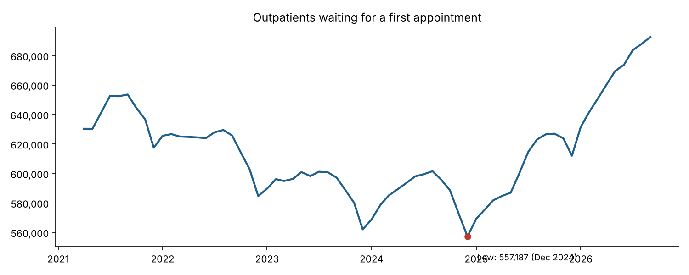
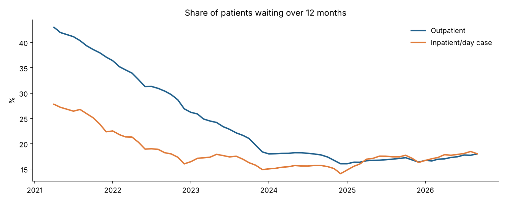
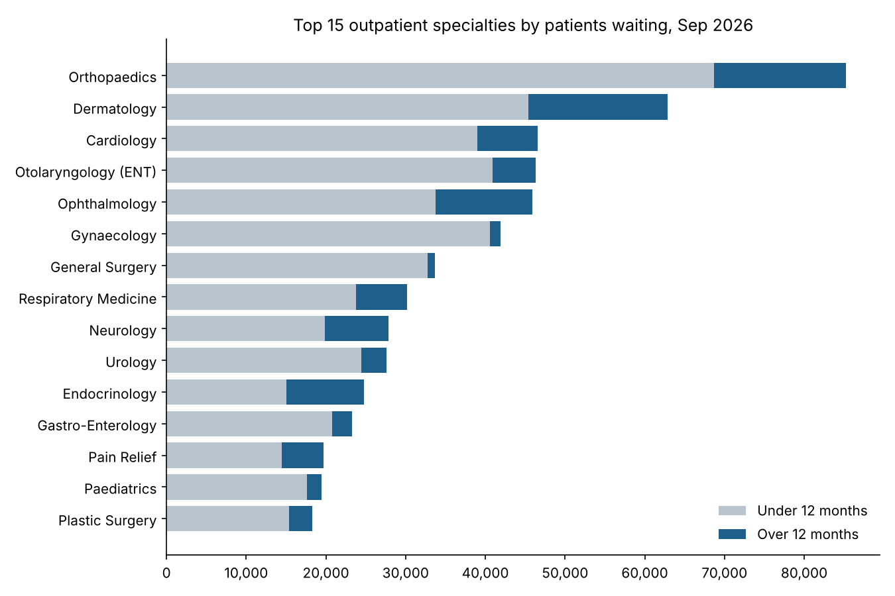
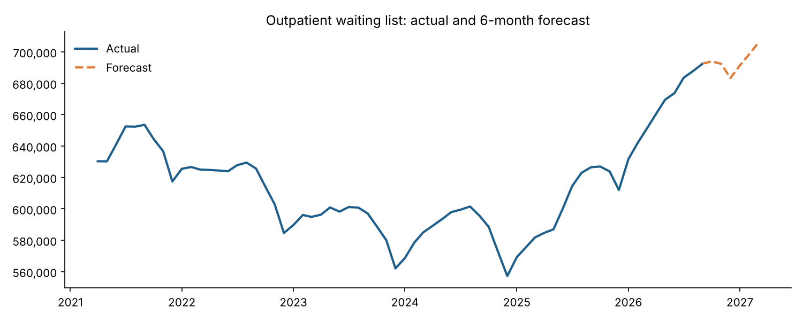

# 🏥 Irish Healthcare Waiting List Intelligence & Demand Forecasting

A data analytics and machine learning project using public open data from the National Treatment Purchase Fund (NTPF) to understand how Irish hospital waiting lists have changed since 2021, and to forecast where the outpatient list is heading next.

## 🎯 The Problem

Waiting lists are one of the biggest pressures on the Irish public health system. Hundreds of thousands of patients are waiting for a first outpatient appointment or a hospital procedure at any one time.

The questions this project answers:

- Is the waiting list getting better or worse, and how fast?
- Are patients waiting longer, or is the list just getting bigger?
- Which specialties and hospitals are under the most pressure?
- Can a model forecast the list accurately enough to help plan capacity, staff and budget?

## 📊 Dataset

| Source | Coverage | Key Fields |
|---|---|---|
| NTPF Outpatient waiting list (by hospital and by specialty) | Apr 2021 – Sep 2026, monthly | Hospital, specialty, adult/child, wait band, total |
| NTPF Inpatient/Day Case waiting list (by hospital and by specialty) | Apr 2021 – Sep 2026, monthly | Hospital, specialty, adult/child, wait band, total |

- **65 monthly snapshots** of the national waiting list
- Wait bands: 0–6, 6–12, 12–18 and 18+ months
- Source: [NTPF Open Data](https://www.ntpf.ie/waiting-list-data/open-data/) (CC-BY 4.0)

The `data/` folder holds the summary tables used in the notebook: national monthly totals by wait band, and September 2026 snapshots by specialty and hospital. The raw NTPF files are not committed; `src/analysis.py` rebuilds everything from them.

## What I Actually Did

### Data Collection & Cleaning

NTPF publishes separate yearly CSV files, and the format has changed over the years. Using Python (Pandas):

- Combined the outpatient and inpatient/day case files by hospital and by specialty for 2021–2026
- Standardised column names across file versions and converted wide wait-band columns into one consistent format
- Parsed dates and numbers stored as text (e.g. `"1,178"`)
- **Avoided double counting:** NTPF publishes the same national list twice (once by hospital, once by specialty), so national totals were built from the hospital files only

### Data Quality Checks

- **June 2021 is missing** from the open data, the period of the 2021 HSE cyberattack. It was filled by linear interpolation for the forecast only
- **Wait-band totals differ slightly from published totals** in most months, by at most 29 patients out of 600,000+ (under 0.01%). NTPF adjusts small counts for privacy, so this is expected and does not affect the findings
- No other missing values

### Feature Engineering

- **% waiting over 12 months:** (12–18 months + 18+ months) / total
- **Year-on-year change** for the national list, each specialty and each hospital
- **Forecasting features:** month-to-month change 1, 2, 3, 6 and 12 months earlier, a 3-month rolling average and month of the year

### Exploratory Data Analysis (EDA)

- National trend for outpatient and inpatient/day case lists
- Share of long waiters over time
- Top 15 specialties and top 12 hospitals by patients waiting, with change since September 2025

### Forecasting Model

Built a **Random Forest** model to forecast the outpatient list 6 months ahead.

**Why model the monthly change, not the total?** A Random Forest cannot predict values outside the range it was trained on. The list hit a record high in 2026, so a model trained on the total would always under-forecast. The model predicts the month-to-month change instead, which is added to the last known figure.

**How it was tested:** walk-forward validation on the last 6 months. Each month was predicted using only the months before it, then compared with a simple baseline (repeat last month's figure). A model only adds value if it beats that baseline.

| Waiting List | Random Forest Error | Repeat-Last-Month Error | Result |
|---|---|---|---|
| Outpatient | **0.49%** | 1.03% | ✅ Model halves the error |
| Inpatient/Day Case | 0.87% | **0.49%** | ❌ Baseline is better |

For inpatient/day case, the list changes so steadily that repeating last month is already very accurate. I report this rather than hide it: knowing when a model does *not* help is as important as knowing when it does.

## Key Findings

### 1. The List Is Growing Again

- Outpatients waiting: **630,309 (Apr 2021) → 692,524 (Sep 2026)**, up 9.9%
- Up **10.5% in the last year alone**
- The list hit its lowest point of **557,187 in December 2024** and has risen **24.3%** since



### 2. But Patients Are Waiting Less Long

- Share of outpatients waiting **over 12 months fell from 43.0% to 18.0%**
- Outpatients waiting **over 18 months fell from 181,185 to 53,458** (down 70.5%)

Waits are getting shorter, but more people are joining the list than are being seen. That points to rising demand, not just slow treatment.



### 3. Inpatient & Day Case Pressure Is Rising Fastest

- Inpatient/day case list: **76,975 → 114,722**, up **49%** since April 2021 and **14.7%** in the last year

### 4. Pressure Is Concentrated in a Few Specialties

| Specialty | Waiting (Sep 2026) | % Over 12 Months | Change in a Year |
|---|---|---|---|
| Orthopaedics | 85,258 | 19.5% | +17.1% |
| Dermatology | 62,846 | 27.7% | −1.6% |
| Cardiology | 46,535 | 16.2% | +13.2% |
| Otolaryngology (ENT) | 46,274 | 11.6% | +5.8% |
| Ophthalmology | 45,902 | 26.5% | +12.1% |

- **Orthopaedics** has the longest list and is still growing fast
- **Dermatology** has the most long waiters: 17,435 patients over 12 months
- **Endocrinology** has the highest long-wait share among the top 15: 39% wait over a year



### 5. Hospitals Under Most Pressure

- **Beaumont Hospital** has the most outpatients waiting (56,012), up 18.5% in a year
- **Midland Regional Hospital Tullamore** grew fastest among the top 12 (up 37.9%), followed by Tallaght (26.0%) and Limerick (24.7%)

### 6. Forecast

The model forecasts around **705,000 outpatients waiting by March 2027**. It also picks up a pattern in the history: the list dips every December, then rises again in the new year.



## 💡 Recommendations

**Priority 1: Target capacity at the growing specialties**
Orthopaedics, Cardiology and Ophthalmology are both large and growing by 12–17% a year. Extra clinics or outsourcing here would have the biggest effect on the national total.

**Priority 2: Clear long waiters in Dermatology and Endocrinology**
These specialties have the highest share of patients waiting over a year. Targeted validation and treatment initiatives would reduce the longest waits fastest.

**Priority 3: Look at demand, not just delivery**
Long waits are falling while the list grows, which suggests referrals are outpacing capacity. Combining this data with referral and activity data would show where demand is coming from.

**Priority 4: Use forecasting for planning**
A monthly forecast lets hospitals plan staff, theatre time and budget ahead of demand, rather than reacting once lists have already grown.

## 🌱 Why This Project Matters

This project shows:

- How public open data can support decisions about public services
- How to build a clean, consistent dataset from files whose format changes over time
- Why a model must be tested against a simple baseline, and reported honestly when it does not beat it
- How to choose the right modelling target (monthly change) when the data is at record levels
- How to turn analysis into clear findings and recommendations for non-technical readers

## ⚠️ Limitations

- NTPF publishes snapshots of patients **waiting**, not referrals or patients treated, so the model forecasts list size, not demand
- 65 months is a short history. Accuracy was tested one month ahead; uncertainty grows over a 6-month horizon
- Specialty and hospital views cover the largest entries only

## 📓 View the Full Analysis

Click `notebooks/irish_waiting_list_analysis.ipynb` to see the full analysis with all charts and results rendered inline.

## 📁 Repository Structure

```
├── data/
│   ├── national_monthly.csv          ← National totals by wait band, Apr 2021 – Sep 2026
│   ├── op_specialty_sep2026.csv      ← Top 15 outpatient specialties
│   ├── ipdc_specialty_sep2026.csv    ← Top 12 inpatient/day case specialties
│   ├── op_hospital_sep2026.csv       ← Top 12 hospitals by outpatients waiting
│   ├── forecast_oct2026_mar2027.csv  ← 6-month forecast
│   └── model_test.csv                ← Model vs baseline test results
├── images/                           ← Chart outputs
├── notebooks/
│   └── irish_waiting_list_analysis.ipynb  ← Analysis and forecasting notebook
├── src/
│   └── analysis.py                   ← Full pipeline from the raw NTPF files
└── README.md
```

## Reproducing the Results

```
git clone https://github.com/Imran3285/irish-hospital-waiting-list-analysis.git
cd irish-hospital-waiting-list-analysis
pip install pandas numpy matplotlib scikit-learn jupyter
jupyter notebook notebooks/irish_waiting_list_analysis.ipynb
```

Run all cells top to bottom. The random seed is fixed at 42, so results are reproducible.

To rebuild from the raw data, download the NTPF files (`OpenData_OPNational01/02`, `OpenData_IPDCNational01/02`) into a `raw_data/` folder and run `python src/analysis.py`.

## Stack

Python · Pandas · NumPy · scikit-learn · Matplotlib · Jupyter Notebook

## Author

Muhammad Imran
