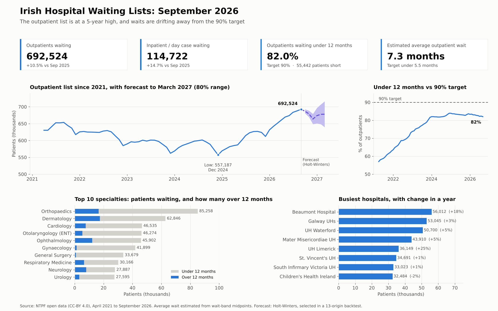
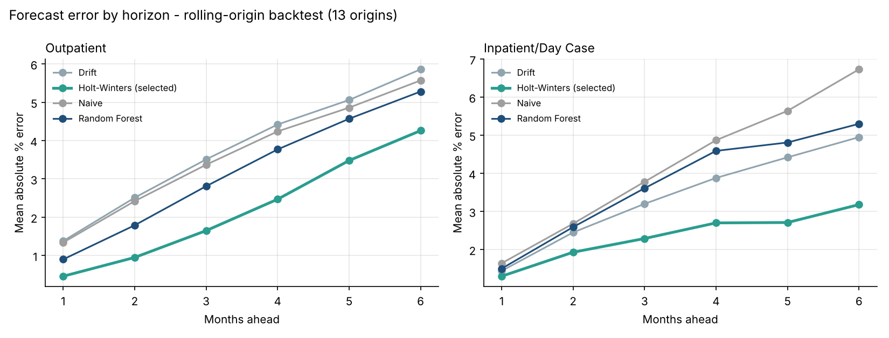
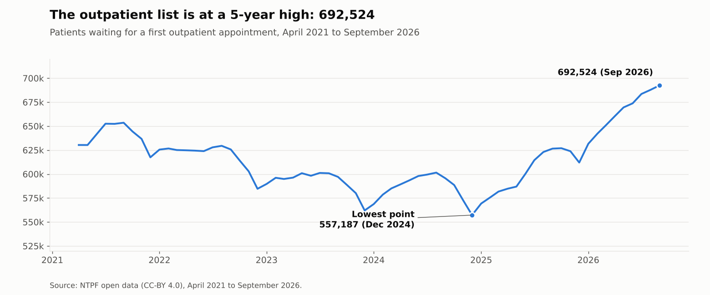
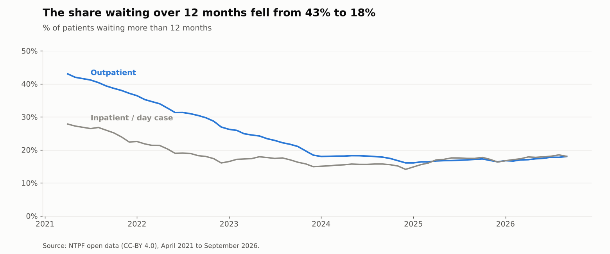
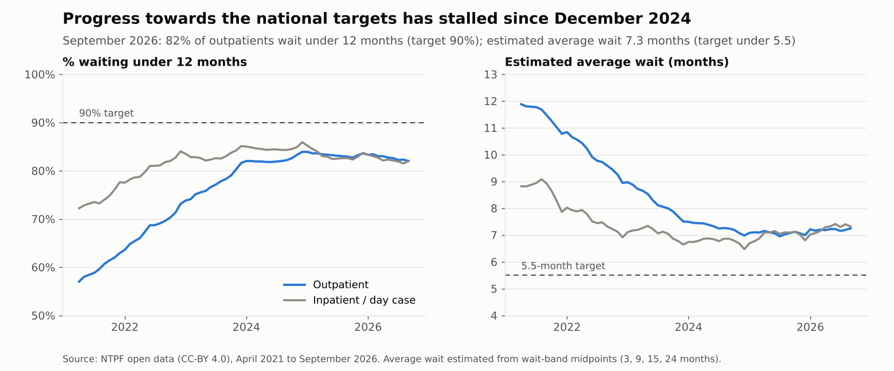
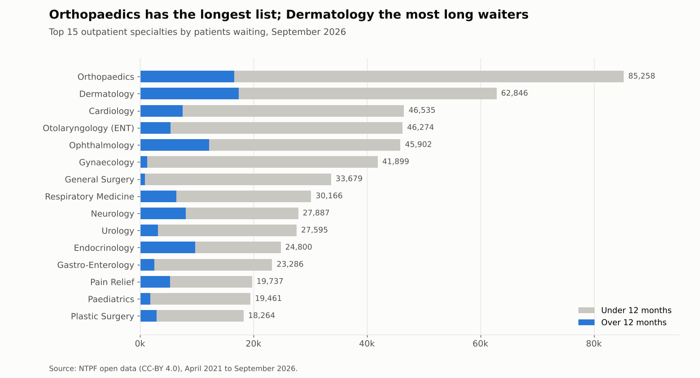
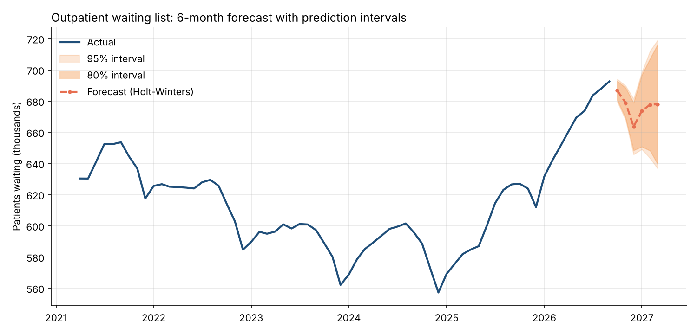

# 🏥 Irish Healthcare Waiting List Intelligence & Demand Forecasting

A data analytics and machine learning project using public open data from the National Treatment Purchase Fund (NTPF) to understand how Irish hospital waiting lists have changed since 2021, measure them against national waiting-time targets, and forecast where they are heading next.

## 📌 Executive Summary

- **The outpatient list is at its highest since 2021: 692,524** (Sep 2026), up 10.5% in a year and 24.3% since its December 2024 low.
- **Waits fell sharply from 2021 to 2024, but progress has stalled.** Only **82%** of outpatients wait under 12 months, against the **90% national target**: **55,442 outpatients** would need to be seen sooner to close the gap.
- **The estimated average wait is ~7.3 months** for both lists, against a **5.5-month target** for 2026, and has risen since December 2024.
- **Holt-Winters beat three other models** in a 13-origin backtest, with 0.46% error one month ahead and 4.3% six months ahead for outpatients. It forecasts **~678,000 outpatients by March 2027 (80% range: 640k–716k)**, including the usual December dip.
- **Pressure is concentrated** in Orthopaedics, Cardiology and Ophthalmology (large and growing) and Dermatology and Endocrinology (most long waiters).

## 📊 Dashboard

One page with the headline KPIs, the trend and forecast, progress against the 90% target, and where pressure is concentrated by specialty and hospital. Built in Python (Matplotlib) by [`src/dashboard.py`](src/dashboard.py) from the tables in `data/`, so it refreshes when the data is updated.



## 🎯 The Problem

Waiting lists are one of the biggest pressures on the Irish public health system. Hundreds of thousands of patients are waiting for a first outpatient appointment or a hospital procedure at any one time.

The questions this project answers:

- Is the waiting list getting better or worse, and how fast?
- Are patients waiting longer, or is the list just getting bigger?
- Which specialties and hospitals are under the most pressure?
- Can a model forecast the list accurately enough to help plan capacity, staff and budget?

## 📊 Dataset

| Source | Coverage | Key Fields |
|---|---|---|
| NTPF Outpatient waiting list (by hospital and by specialty) | Apr 2021 – Sep 2026, monthly | Hospital, specialty, adult/child, wait band, total |
| NTPF Inpatient/Day Case waiting list (by hospital and by specialty) | Apr 2021 – Sep 2026, monthly | Hospital, specialty, adult/child, wait band, total |

- **65 monthly snapshots** of the national waiting list
- Wait bands: 0–6, 6–12, 12–18 and 18+ months
- Source: [NTPF Open Data](https://www.ntpf.ie/waiting-list-data/open-data/) (CC-BY 4.0)

The `data/` folder holds the summary tables used in the notebook: national monthly totals by wait band, and September 2026 snapshots by specialty and hospital. The raw NTPF files are not committed; `src/analysis.py` rebuilds everything from them.

## What I Actually Did

### Data Collection & Cleaning

NTPF publishes separate yearly CSV files, and the format has changed over the years. Using Python (Pandas):

- Combined the outpatient and inpatient/day case files by hospital and by specialty for 2021–2026
- Standardised column names across file versions and converted wide wait-band columns into one consistent format
- Parsed dates and numbers stored as text (e.g. `"1,178"`)
- **Avoided double counting:** NTPF publishes the same national list twice (once by hospital, once by specialty), so national totals were built from the hospital files only

### Data Quality Checks

- **June 2021 is missing** from the open data, the period of the 2021 HSE cyberattack. It was filled by linear interpolation for the forecast only
- **Wait-band totals differ slightly from published totals** in most months, by at most 29 patients out of 600,000+ (under 0.01%). NTPF adjusts small counts for privacy, so this is expected and does not affect the findings
- No other missing values

### Feature Engineering

- **% waiting over 12 months:** (12–18 months + 18+ months) / total
- **Year-on-year change** for the national list, each specialty and each hospital
- **Forecasting features:** month-to-month change 1, 2, 3, 6 and 12 months earlier, a 3-month rolling average and month of the year

### Exploratory Data Analysis (EDA)

- National trend for outpatient and inpatient/day case lists
- Share of long waiters over time
- Top 15 specialties and top 12 hospitals by patients waiting, with change since September 2025

### Forecasting: Model Comparison

The forecast is chosen by **testing four models on the same data** rather than assuming one:

| Model | How it forecasts |
|---|---|
| Naive | Next month = this month (the baseline any model must beat) |
| Drift | This month + the average monthly change so far |
| **Holt-Winters** | Smoothed level + trend + **12-month seasonality** (parameters fitted with SciPy) |
| Random Forest | Predicts the **month-to-month change** from lagged changes, a 3-month rolling mean and calendar month |

**Why the Random Forest models the change, not the total:** a Random Forest cannot predict values outside the range it was trained on, and the list is at a record high, so a model trained on the total would always under-forecast.

**How the models were tested: rolling-origin backtest.** Each model forecast 1–6 months ahead from **13 different starting points**, using only the data available at that point, and was scored against what actually happened.

| Mean absolute % error | 1 month ahead | 3 months | 6 months | Average (1–6) |
|---|---|---|---|---|
| **Outpatient – Holt-Winters** ✅ | **0.46%** | **1.65%** | **4.26%** | **2.21%** |
| Outpatient – Random Forest | 0.90% | 2.81% | 5.28% | 3.19% |
| Outpatient – Naive | 1.34% | 3.37% | 5.57% | 3.63% |
| **Inpatient/Day Case – Holt-Winters** ✅ | **1.30%** | **2.29%** | **3.18%** | **2.35%** |
| Inpatient/Day Case – Random Forest | 1.50% | 3.61% | 5.30% | 3.73% |
| Inpatient/Day Case – Naive | 1.64% | 3.78% | 6.73% | 4.22% |

Full results for all models are in [`data/model_comparison.csv`](data/model_comparison.csv).



**Holt-Winters wins at every horizon for both lists** because it captures the seasonal December dip that the other models miss.

> An earlier version of this project used only the Random Forest, tested one month ahead over 6 months (0.49% error). Extending the test to 13 origins and 6-month horizons showed Holt-Winters is more accurate over the planning horizon that matters, so the forecast now uses it. Testing more broadly changed the answer, which is the point of testing.

**Prediction intervals.** Each forecast comes with **80% and 95% ranges** built from the selected model's own backtest errors at each horizon (no distribution assumed). Uncertainty widens from about ±1% one month ahead to about ±6% six months ahead.

### Benchmarking Against National Targets

Healthcare managers judge waiting lists against national targets, so the data was measured against the targets that can be calculated from it:

| Target | Source | Measured as |
|---|---|---|
| 90% of outpatients waiting under 12 months | Waiting List Action Plan 2025 | (0–6 + 6–12 month bands) ÷ total |
| Weighted average wait under 5.5 months (OPD and IPDC) | Waiting Time Action Plan 2026 | Band midpoints 3, 9, 15 and 24 months, weighted by patients |
| Sláintecare maximums: 10 weeks (OPD), 12 weeks (IPDC) | Sláintecare Report 2017 | **Not measurable** with 6-month bands; the 0–6 month share is an upper bound |

**Validation of the estimate:** for December 2025 the estimated outpatient weighted average is **7.0 months**, against **6.8 months** published by the Department of Health. In September 2021 it underestimates (11.5 vs 12.8 months published), because long waiters then waited well beyond the 24-month assumption, so early figures are treated as a lower bound.

## Key Findings

### 1. The List Is Growing Again

- Outpatients waiting: **630,309 (Apr 2021) → 692,524 (Sep 2026)**, up 9.9%
- Up **10.5% in the last year alone**
- The list hit its lowest point of **557,187 in December 2024** and has risen **24.3%** since



### 2. But Patients Are Waiting Less Long

- Share of outpatients waiting **over 12 months fell from 43.0% to 18.0%**
- Outpatients waiting **over 18 months fell from 181,185 to 53,458** (down 70.5%)

Waits are getting shorter, but more people are joining the list than are being seen. That points to rising demand, not just slow treatment.



### 3. Progress Towards National Targets Has Stalled

| Measure (Sep 2026) | Outpatient | Inpatient/Day Case | Target |
|---|---|---|---|
| % waiting under 12 months | **82.0%** (Dec 2024: 83.9%) | **82.0%** (Dec 2024: 85.9%) | 90% (set for outpatients; applied to both for comparison) |
| Patients to move under 12 months to reach 90% | **55,442** | **9,204** | 0 |
| Estimated weighted average wait | **7.3 months** (Dec 2024: 7.0) | **7.3 months** (Dec 2024: 6.5) | under 5.5 months |
| % waiting under 6 months (upper bound for the 10/12-week maximums) | 58.8% | 59.0% | 100% |

- From 2021 to 2024, the share waiting under 12 months rose from 57% to 84% for outpatients, a major improvement.
- **Since December 2024 it has slipped back** on both lists, and the average wait has started rising again, because the list is growing faster than it is being cleared.



### 4. Inpatient & Day Case Pressure Is Rising Fastest

- Inpatient/day case list: **76,975 → 114,722**, up **49%** since April 2021 and **14.7%** in the last year

### 5. Pressure Is Concentrated in a Few Specialties

| Specialty | Waiting (Sep 2026) | % Over 12 Months | Change in a Year |
|---|---|---|---|
| Orthopaedics | 85,258 | 19.5% | +17.1% |
| Dermatology | 62,846 | 27.7% | −1.6% |
| Cardiology | 46,535 | 16.2% | +13.2% |
| Otolaryngology (ENT) | 46,274 | 11.6% | +5.8% |
| Ophthalmology | 45,902 | 26.5% | +12.1% |

- **Orthopaedics** has the longest list and is still growing fast
- **Dermatology** has the most long waiters: 17,435 patients over 12 months
- **Endocrinology** has the highest long-wait share among the top 15: 39% wait over a year



### 6. Hospitals Under Most Pressure

- **Beaumont Hospital** has the most outpatients waiting (56,012), up 18.5% in a year
- **Midland Regional Hospital Tullamore** grew fastest among the top 12 (up 37.9%), followed by Tallaght (26.0%) and Limerick (24.7%)

### 7. Forecast: The List Stays Near Record Levels

| Month | Outpatient forecast | 80% range | Inpatient/Day Case forecast | 80% range |
|---|---|---|---|---|
| Oct 2026 | 686,763 | 680k – 693k | 117,601 | 115k – 120k |
| Dec 2026 | 663,583 | 648k – 679k | 120,040 | 116k – 124k |
| Mar 2027 | **677,898** | **640k – 716k** | **124,461** | **117k – 131k** |

- The **outpatient list is expected to dip in December** (the seasonal pattern seen every year), then rise again, staying near **680,000**.
- The **inpatient/day case list keeps growing**, to about **124,000 by March 2027**.
- Full figures: [`data/forecast_with_intervals.csv`](data/forecast_with_intervals.csv).



## 💡 Recommendations

**Priority 1: Target capacity at the growing specialties**
Orthopaedics, Cardiology and Ophthalmology are both large and growing by 12–17% a year. Extra clinics or outsourcing here would have the biggest effect on the national total.

**Priority 2: Clear long waiters in Dermatology and Endocrinology**
These specialties have the highest share of patients waiting over a year. Targeted validation and treatment initiatives would reduce the longest waits fastest.

**Priority 3: Focus on the 12–18 month band to recover the 90% target**
55,442 outpatients and 9,204 inpatient/day case patients separate the current position from the 90% target. Treating patients before they cross 12 months, starting with the 12–18 month band, is the most direct route back towards it.

**Priority 4: Look at demand, not just delivery**
Long waits are falling while the list grows, which suggests referrals are outpacing capacity. Combining this data with referral and activity data would show where demand is coming from.

**Priority 5: Plan with ranges, not single numbers**
The forecast's 80% range lets hospitals plan staff, theatre time and budget for a realistic best and worst case, rather than reacting once lists have already grown.

## 🌱 Why This Project Matters

This project shows:

- How public open data can support decisions about public services
- How to build a clean, consistent dataset from files whose format changes over time
- Why a model must be tested against a simple baseline, and reported honestly when it does not beat it
- How to choose the right modelling target (monthly change) when the data is at record levels
- How to compare several models fairly with a rolling-origin backtest, and report uncertainty as prediction intervals
- How to measure performance against the national targets that managers are held to, and validate an estimate against published figures
- How to turn analysis into clear findings and recommendations for non-technical readers

## ⚠️ Limitations

- NTPF publishes snapshots of patients **waiting**, not referrals or patients treated, so the model forecasts list size, not demand
- 65 months is a short history. Accuracy was tested one month ahead; uncertainty grows over a 6-month horizon
- Specialty and hospital views cover the largest entries only
- The weighted average wait is an **estimate** from 6-month bands (18+ months assumed to be 24 months). It is within 0.2 months of the published figure for December 2025 but underestimates earlier periods
- The 10-week and 12-week Sláintecare maximums cannot be measured from 6-month bands
- Prediction intervals come from 13 backtest errors per horizon, so the 95% range is close to the worst error observed and may understate rare shocks

## 📓 View the Full Analysis

Click `notebooks/irish_waiting_list_analysis.ipynb` to see the full analysis with all charts and results rendered inline.

## 📁 Repository Structure

```
├── data/
│   ├── national_monthly.csv          ← National totals by wait band, Apr 2021 – Sep 2026
│   ├── op_specialty_sep2026.csv      ← Top 15 outpatient specialties
│   ├── ipdc_specialty_sep2026.csv    ← Top 12 inpatient/day case specialties
│   ├── op_hospital_sep2026.csv       ← Top 12 hospitals by outpatients waiting
│   ├── forecast_with_intervals.csv   ← 6-month forecast with 80% / 95% intervals (selected model)
│   ├── model_comparison.csv          ← Backtest error by model and horizon
│   ├── target_benchmark.csv          ← Monthly performance against national targets
│   ├── forecast_oct2026_mar2027.csv  ← Earlier Random Forest-only forecast (superseded)
│   └── model_test.csv                ← Earlier Random Forest vs baseline test
├── images/                           ← Chart outputs
├── notebooks/
│   └── irish_waiting_list_analysis.ipynb  ← Analysis and forecasting notebook
├── src/
│   ├── analysis.py                   ← Full pipeline from the raw NTPF files
│   ├── forecast_and_targets.py       ← Model comparison, prediction intervals, target benchmarking
│   ├── chart_style.py                ← Shared colours, fonts and layout for every chart
│   ├── charts.py                     ← Draws all README charts in one consistent style
│   └── dashboard.py                  ← One-page dashboard (images/00_dashboard.png)
└── README.md
```

## Reproducing the Results

```
git clone https://github.com/Imran3285/irish-hospital-waiting-list-analysis.git
cd irish-hospital-waiting-list-analysis
pip install pandas numpy matplotlib scikit-learn jupyter
jupyter notebook notebooks/irish_waiting_list_analysis.ipynb
```

Run all cells top to bottom. The random seed is fixed at 42, so results are reproducible.

The model comparison, forecast intervals and target benchmark run directly from the summary data in this repository:

```
pip install pandas numpy scipy scikit-learn matplotlib
python src/forecast_and_targets.py
python src/charts.py
python src/dashboard.py
```

To rebuild from the raw data, download the NTPF files (`OpenData_OPNational01/02`, `OpenData_IPDCNational01/02`) into a `raw_data/` folder and run `python src/analysis.py`.

## Stack

Python · Pandas · NumPy · SciPy · scikit-learn · Matplotlib · Jupyter Notebook

## References

- NTPF Open Data – [ntpf.ie/waiting-list-data/open-data](https://www.ntpf.ie/waiting-list-data/open-data/)
- Department of Health – [Waiting List Action Plan 2025](https://www.gov.ie/en/department-of-health/press-releases/minister-carroll-macneill-publishes-the-waiting-list-action-plan-2025/) and [Waiting Time Action Plan 2026](https://www.gov.ie/en/department-of-health/press-releases/minister-for-health-publishes-the-waiting-time-action-plan-2026)
- Department of Health – [Monthly waiting list figures, January 2026](https://www.gov.ie/en/department-of-health/press-releases/monthly-waiting-list-figures-january-2026) (Sláintecare maximum wait times)
- The Irish Times – [Health service failed to meet goal for cuts to hospital waiting lists in 2025](https://www.irishtimes.com/health/2026/01/09/health-service-failed-to-meet-goal-for-cuts-to-hospital-waiting-lists-in-2025/) (90% under-12-months target)
- Medical Independent – [WTAP 2026 targets](https://www.medicalindependent.ie/2026/01/30/the-implementation-of-the-new-the-waiting-time-action-plan-wtap-2026-will-be-overseen-by-the-waiting-list-task-force/) and [published weighted average wait times](https://www.medicalindependent.ie/2026/02/09/high-demand-slows-progress-on-waiting-lists/)

## Author

Muhammad Imran
